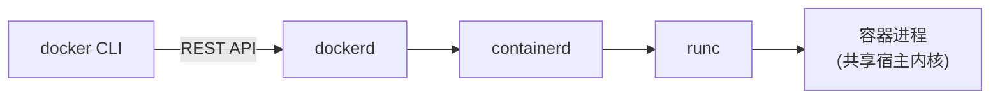

---
tags:
  - Docker
  - 入门
created: 2026-11-06
---

# 01 Docker 简介

> [!info] 参考
> <https://yeasy.gitbook.io/docker_practice/01_introduction>

## 1.1 它到底是什么

Docker 是一个用 Go 写的 **C/S 架构**容器管理工具：

- 客户端 `docker` 发命令 → 守护进程 `dockerd` 收命令 → 调用 containerd / runc 真正把进程跑起来
- 容器之间共享宿主机内核，靠 **namespace**（隔离视图）、**cgroups**（限制资源）、**UnionFS**（分层文件系统）实现"看起来像独立机器"

所以严格说：**容器不是轻量虚拟机，而是被限制和隔离的普通进程**。

## 1.2 和虚拟机的区别

| 维度 | 虚拟机 | Docker 容器 |
| --- | --- | --- |
| 隔离级别 | 硬件虚拟化，各自跑完整 OS | 进程级隔离，共享宿主内核 |
| 启动速度 | 分钟级 | 秒级甚至更快 |
| 体积 | GB 级 | MB ~ 百 MB |
| 资源开销 | 每台预留整套 OS 资源 | 几乎无额外内核开销 |
| 隔离强度 | 强（硬件边界） | 较弱（内核共享，需额外加固） |
| 典型用途 | 异构 OS、强隔离多租户 | 应用打包交付、微服务、CI |

> [!warning] 容器不能替代虚拟机的场景
> 需要不同内核版本、需要加载内核模块、需要强安全边界（多租户不可信代码）时，仍应使用虚拟机或安全容器（Kata / gVisor，见 [[09-进阶与生态]]）。

## 1.3 为什么要用

1. **环境一致**：开发、测试、生产跑同一个镜像，依赖版本不再靠口头约定
2. **交付快**：镜像即交付物，`docker run` 就能起，不用写一页部署文档
3. **密度高**：一台机器跑十几个服务，比开十几台虚拟机划算
4. **易回滚**：镜像按 tag 版本化，回退就是换个 tag
5. **贴合 CI/CD**：构建、测试、发布都能在容器里做，流水线干净

## 1.4 它不解决什么

- 不解决**应用本身的架构问题**（单体还是微服务，和用不用 Docker 无关）
- 不自动带来**高可用**，跨机器调度需要编排系统（K8s / Swarm）
- 不做**数据备份**，卷里的数据仍要自己备份
- 不保证**安全**，镜像来源、运行权限都要自己管

## 1.5 生态里常见的几个名字

| 名字 | 作用 |
| --- | --- |
| Docker Engine | 引擎本体：`dockerd` + CLI |
| Docker Desktop | Windows / macOS 上的桌面版，内含 Linux 虚拟机 |
| Docker Compose | 单机多容器编排，见 [[08-Docker-Compose]] |
| Docker Hub | 官方公共镜像仓库 |
| containerd | 被 K8s、Docker 共用的容器运行时 |
| Podman | 无守护进程的替代品，命令基本兼容 |

> [!tip] 记住一句话
> **一次构建，到处运行**——前提是架构一致（x86 镜像不能在 ARM 上直接跑，需要用 Buildx 构建多架构镜像）。
