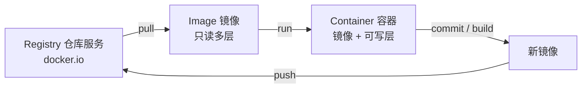
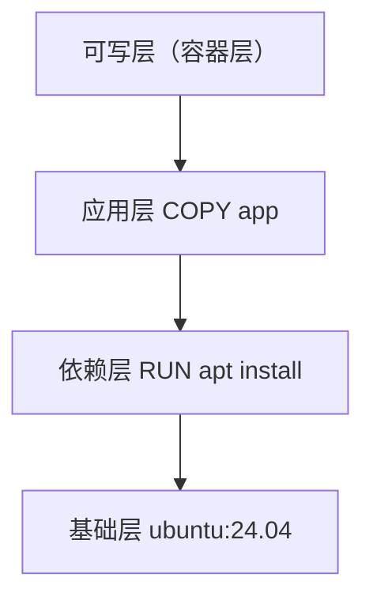
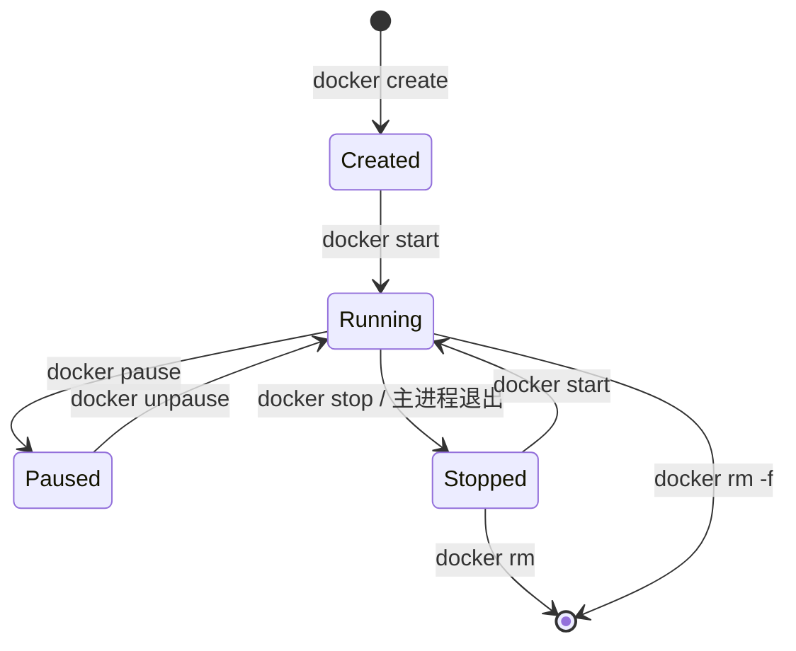

---
tags:
  - Docker
  - 入门
  - 概念
created: 2026-11-06
---

# 02 基本概念

> [!info] 参考
> <https://yeasy.gitbook.io/docker_practice/02_basic_concept>

## 2.1 三者关系



| 概念 | 定义 | 一句话 |
| --- | --- | --- |
| 镜像 Image | 只读的、分层的文件系统模板 | 相当于"安装包 / 类" |
| 容器 Container | 镜像 + 一层可写层 + 一个运行中的进程 | 相当于"实例 / 对象" |
| 仓库 Registry | 集中存放镜像的服务 | 相当于"应用商店" |

## 2.2 镜像名的完整写法

```
[registry地址[:端口]/][命名空间/]仓库名[:标签]
```

| 写法 | 实际指向 |
| --- | --- |
| `nginx` | `docker.io/library/nginx:latest` |
| `nginx:1.28` | 同上，标签 1.28 |
| `bitnami/nginx` | `docker.io/bitnami/nginx:latest` |
| `registry.example.com:5000/team/app:v1` | 私有仓库里的镜像 |

> [!warning] 别依赖 `latest`
> 不写 tag 就等于 `latest`，而 `latest` 会被覆盖。生产环境请显式写版本号，否则"昨天还能跑"会变成玄学。

## 2.3 分层：镜像为什么省空间

镜像由一层层只读层叠加而成，每条 `RUN` / `COPY` 之类通常产生一层。相同的基础层在不同镜像间**复用**，所以本地存 10 个基于 `ubuntu:24.04` 的镜像，不会存 10 份 ubuntu。



- 镜像层：**只读**，可被多容器共享
- 容器层：**可写**，容器删除即消失
- 写入文件时用 **Copy-on-Write**：先复制到可写层再改，所以容器里的改动不会污染镜像

> [!tip] 这条原理的实用推论
> 容器里 `apt install` 的东西，容器一删就没了；要持久化就用镜像（写进 Dockerfile）或数据卷（见 [[07-数据与网络]]）。

## 2.4 容器生命周期



关键点：**容器活着的前提是主进程（PID 1）活着**。主进程退出，容器就退出——哪怕里面还有别的后台进程。

## 2.5 一次 `docker run` 背后发生了什么

1. 本地找镜像，没有就去 Registry 拉
2. 创建可写层，组装容器文件系统
3. 创建网络命名空间、分配 IP（默认 bridge）
4. 创建 namespace、设置 cgroups 限制
5. 启动 `ENTRYPOINT` + `CMD` 指定的进程

> [!tip] 调试思路
> 容器起不来时，按这个顺序查：镜像拉到了吗 → 命令写对了吗 → 端口冲突吗 → 日志说什么（`docker logs`）→ 进得去吗（`docker exec`）。
