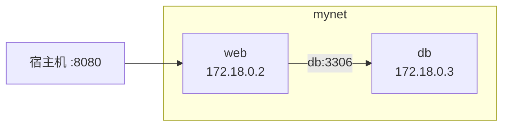

---
tags:
  - Docker
  - 数据卷
  - 网络
created: 2026-11-06
---

# 07 数据与网络

> [!info] 参考
> 数据管理：<https://yeasy.gitbook.io/docker_practice/08_data>
> 网络配置：<https://yeasy.gitbook.io/docker_practice/09_network>

## 7.1 容器里的数据为什么会丢

容器的可写层随容器删除而删除。要持久化只有三条路：

| 方式 | 存储位置 | 典型用途 |
| --- | --- | --- |
| **数据卷 volume** | Docker 管理的 `/var/lib/docker/volumes` | 数据库、需要备份的持久数据 |
| **绑定挂载 bind mount** | 宿主机任意目录 | 开发时挂源码、挂配置文件 |
| **tmpfs** | 内存 | 临时缓存、敏感数据 |

## 7.2 数据卷

```bash
docker volume create mysql-data
docker volume ls
docker volume inspect mysql-data
docker volume rm mysql-data
docker volume prune            # 清理没被使用的
```

使用：

```bash
docker run -d --name mysql \
  -v mysql-data:/var/lib/mysql \
  -e MYSQL_ROOT_PASSWORD=123456 \
  mysql:8
```

特点：

- 生命周期独立于容器，容器删了卷还在
- 多个容器可挂同一个卷（注意并发写冲突）
- 性能优于绑定挂载（不经过宿主机路径映射）
- 用 `docker volume ls` 管理，位置对用户透明

> [!tip] 备份卷
> 用临时容器打包：`docker run --rm -v mysql-data:/data -v ${PWD}:/backup ubuntu tar czf /backup/mysql.tar.gz -C /data .`

## 7.3 绑定挂载

```bash
docker run -d --name web \
  -v $(pwd)/html:/usr/share/nginx/html:ro \
  -v $(pwd)/nginx.conf:/etc/nginx/nginx.conf:ro \
  -p 8080:80 nginx
```

PowerShell 里用 `${PWD}`：

```powershell
docker run -d --name web -v ${PWD}/html:/usr/share/nginx/html:ro -p 8080:80 nginx
```

| 选项 | 含义 |
| --- | --- |
| `:ro` | 只读 |
| `:rw` | 读写（默认） |
| `:z` / `:Z` | SELinux 标签（CentOS/RHEL 常见） |

> [!warning] 两个经典坑
> 1. 宿主机路径**不存在**时，Docker 会自动建一个**空目录**，容器里看到的也是空的——配置"没生效"多半是这个原因。
> 2. 挂载会**覆盖**容器内该路径原有内容。挂 `/etc/nginx` 整个目录，镜像里自带的配置就全没了。

## 7.4 tmpfs

```bash
docker run -d --name app --tmpfs /tmp:size=64m,mode=1777 myapp
```

数据只存在内存，容器停止即消失。适合放 session、临时上传缓冲。

## 7.5 网络类型

```bash
docker network ls
```

默认三个：`bridge`、`host`、`none`。

| 驱动 | 说明 | 场景 |
| --- | --- | --- |
| `bridge` | 默认，NAT 到宿主机 | 绝大多数单机场景 |
| `host` | 直接用宿主机网络栈，无端口映射 | 追求极致网络性能 |
| `none` | 无网络 | 完全隔离的批处理 |
| `overlay` | 跨主机 | Swarm 集群 |
| `macvlan` | 容器有独立 MAC，像物理机 | 需要接入现有物理网络 |

```bash
# host 模式：容器内 80 端口就是宿主机 80
docker run -d --network host nginx
```

> [!warning] host 模式在 Docker Desktop 上不可用
> Windows / macOS 的 Docker 跑在虚拟机里，`--network host` 指向的是那台虚拟机，不是你的电脑。

## 7.6 自定义网络（推荐）

默认 bridge 只能用 IP 互访。自定义网络自带 **DNS 解析**，容器之间可以直接用**容器名**通信：

```bash
docker network create mynet

docker run -d --name db  --network mynet -e MYSQL_ROOT_PASSWORD=123456 mysql:8
docker run -d --name web --network mynet -p 8080:80 nginx

# web 容器里可以直接 ping db / 访问 db:3306
docker exec -it web ping db
```



其他操作：

```bash
docker network connect mynet web       # 运行中的容器接入网络
docker network disconnect mynet web
docker network inspect mynet
docker network rm mynet
```

> [!tip] 这就是 Compose 的默认行为
> `docker compose` 会自动创建一个网络，服务名就是主机名。手写 `docker run` 时也照这个思路做，代码里的连接地址写服务名而非 IP，就不会因为重启换 IP 而挂掉。

## 7.7 端口映射

```bash
-p 8080:80              # 宿主机 8080 → 容器 80
-p 127.0.0.1:8080:80    # 只监听回环，外网访问不到
-p 8080:80/udp          # UDP
-p 80                   # 宿主机随机端口
```

> [!warning] 端口冲突
> `Bind for 0.0.0.0:8080 failed: port is already allocated` 表示宿主机端口被占用。换端口，或 `netstat -ano | findstr :8080`（Windows）/ `ss -lntp`（Linux）找到占用进程。

## 7.8 容器互联的演进

| 方式 | 状态 | 说明 |
| --- | --- | --- |
| `--link` | 已废弃 | 早期方案，单向、靠 `/etc/hosts` |
| 自定义网络 | **推荐** | 双向、DNS 解析、可动态接入 |
| Compose 服务名 | 推荐 | 本质也是自定义网络 |

## 7.9 网络排查

```bash
docker exec -it web sh -c "cat /etc/resolv.conf"   # 看 DNS（应为 127.0.0.11）
docker exec -it web ping db                       # 名称解析通不通
docker exec -it web wget -qO- http://db:3306      # 端口通不通
docker network inspect mynet --format '{{json .Containers}}'
```

> [!tip] 容器里没装 ping / curl
> 用 `docker run --rm --network mynet nicolaka/netshoot` 起一个自带全套网络工具的临时容器来测。
