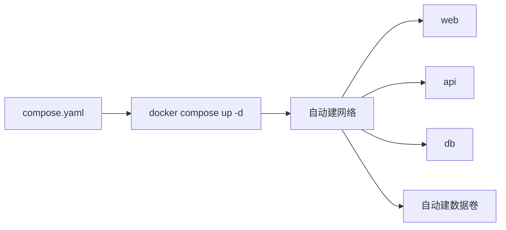

---
tags:
  - Docker
  - Compose
  - 编排
created: 2026-11-06
---

# 08 Docker Compose

> [!info] 参考
> <https://yeasy.gitbook.io/docker_practice/11_compose>

## 8.1 解决什么问题

一条 `docker run` 已经很长了，五六个服务互相依赖时更是没法维护。Compose 用**一个 YAML 描述所有服务**，一条命令起停。



它管的是**单机多容器**；跨机器集群要用 K8s。

## 8.2 安装

装 `docker-compose-plugin` 后即自带，命令是 `docker compose`（v2，空格）。

```bash
sudo apt install -y docker-compose-plugin
docker compose version
```

> [!warning] `docker-compose` 与 `docker compose`
> 前者是 v1（Python 写的，已停止维护），后者是 v2（Go 插件）。新环境统一用 v2，网上老教程里的 `docker-compose` 别照抄。

## 8.3 一个完整例子

`compose.yaml`：

```yaml
name: demo

services:
  web:
    image: nginx:1.28-alpine
    ports:
      - "8080:80"
    volumes:
      - ./html:/usr/share/nginx/html:ro
    depends_on:
      - api
    restart: unless-stopped

  api:
    build:
      context: ./api
      dockerfile: Dockerfile
    environment:
      DATABASE_URL: ${DATABASE_URL}
    depends_on:
      db:
        condition: service_healthy

  db:
    image: postgres:16
    environment:
      POSTGRES_USER: app
      POSTGRES_PASSWORD: secret
      POSTGRES_DB: app
    volumes:
      - pgdata:/var/lib/postgresql/data
    healthcheck:
      test: ["CMD-SHELL", "pg_isready -U app"]
      interval: 5s
      retries: 10

volumes:
  pgdata:
```

要点：

- **服务名就是主机名**，`api` 里连数据库写 `db:5432` 即可
- 不用写 `networks`，Compose 自动建一个默认网络
- `volumes:` 顶层声明具名卷，服务里引用
- `depends_on` 只保证**启动顺序**，不保证服务真的就绪——需要健康检查 + `condition: service_healthy`

## 8.4 常用命令

| 命令 | 作用 |
| --- | --- |
| `docker compose up -d` | 后台启动全部服务（必要时构建） |
| `docker compose up -d --build` | 强制重新构建镜像 |
| `docker compose ps` | 看服务状态 |
| `docker compose logs -f api` | 跟踪某个服务日志 |
| `docker compose exec api sh` | 进容器 |
| `docker compose restart api` | 重启单个服务 |
| `docker compose stop` / `start` | 停止 / 启动（保留容器） |
| `docker compose down` | 停止并删除容器、网络 |
| `docker compose down -v` | 连数据卷一起删（**数据会没**） |
| `docker compose config` | 校验并展开最终配置 |
| `docker compose pull` | 拉取最新镜像 |

> [!warning] `down -v` 会删数据卷
> 开发时图省事常用，但只要有真实数据，先确认卷里没东西。

## 8.5 常用字段

| 字段 | 说明 |
| --- | --- |
| `image` | 直接用现成镜像 |
| `build` | 从 Dockerfile 构建（`context` + `dockerfile` + `args`） |
| `ports` | 端口映射，同 `-p` |
| `expose` | 只对内部网络暴露 |
| `environment` / `env_file` | 环境变量 |
| `volumes` | 挂载 |
| `depends_on` | 依赖顺序 |
| `restart` | 重启策略 |
| `healthcheck` | 健康检查 |
| `command` / `entrypoint` | 覆盖镜像默认值 |
| `profiles` | 按需启用某些服务 |
| `deploy.resources` | 资源限制（Compose 下部分生效） |

## 8.6 环境变量与 `.env`

同目录放 `.env`：

```dotenv
POSTGRES_PASSWORD=secret
TAG=1.28-alpine
```

YAML 里引用：

```yaml
services:
  web:
    image: nginx:${TAG}
    environment:
      DB_PASSWORD: ${POSTGRES_PASSWORD}
```

> [!warning] `.env` 不要提交到 Git
> 里面通常是密码。放进 `.gitignore`，另存一份 `.env.example` 说明需要哪些变量。

## 8.7 多环境

基础文件 + 覆盖文件：

```bash
docker compose -f compose.yaml -f compose.prod.yaml up -d
```

`compose.prod.yaml` 只写差异（如去掉源码挂载、换镜像 tag），Compose 会做合并。

## 8.8 和 K8s 的分界

| | Compose | Kubernetes |
| --- | --- | --- |
| 范围 | 单机 | 集群 |
| 学习成本 | 低 | 高 |
| 自愈 / 扩缩容 | 基本没有 | 有 |
| 适合 | 开发环境、小项目、单机部署 | 生产多副本、需要调度 |

> [!tip] 务实的选择
> 一台服务器能扛住就别上 K8s。Compose + `restart: unless-stopped` 已经能覆盖很多内部系统的需求。
