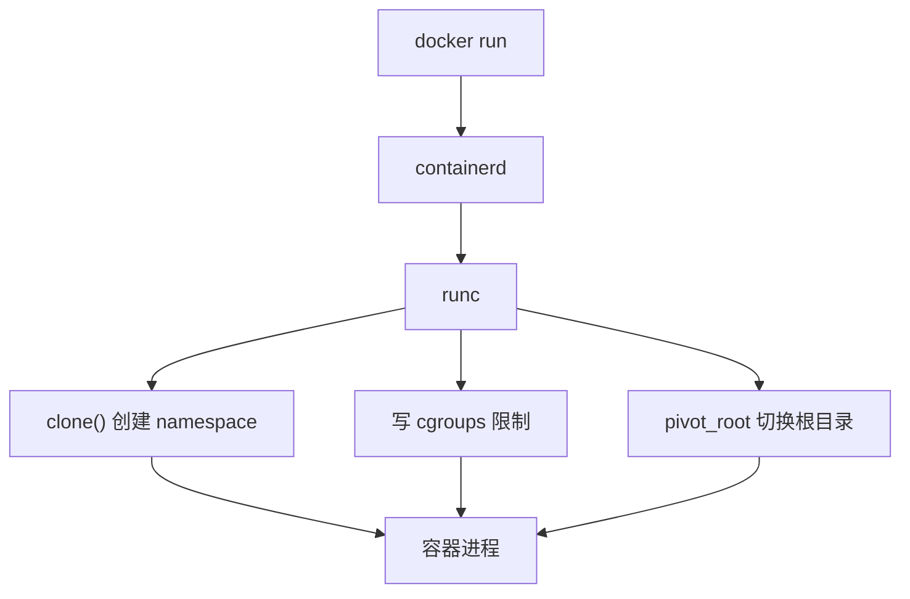

---
tags:
  - Docker
  - 进阶
  - Buildx
  - Kubernetes
created: 2026-11-06
---

# 09 进阶与生态

> [!info] 参考
> Buildx：<https://yeasy.gitbook.io/docker_practice/10_buildx>
> 底层实现：<https://yeasy.gitbook.io/docker_practice/12_implementation>
> 容器编排：<https://yeasy.gitbook.io/docker_practice/13_kubernetes_concepts>
> 安全：<https://yeasy.gitbook.io/docker_practice/18_security>
> 生态：<https://yeasy.gitbook.io/docker_practice/17_ecosystem>

## 9.1 Buildx 与 BuildKit

BuildKit 是新一代构建引擎，buildx 是它的 CLI 前端。相比老的 `docker build`：

- 并行构建、缓存更聪明
- 支持多架构构建（一次产出 amd64 + arm64）
- 支持 secret 挂载、SSH 转发、缓存导出

```bash
docker buildx ls
docker buildx create --name mybuilder --use --driver docker-container
docker buildx inspect --bootstrap
docker buildx build -t myapp:v1 --load .
```

> [!warning] 结果默认不进本地镜像库
> 用 `docker-container` 驱动构建时，不加 `--load`（进本地）或 `--push`（推仓库）或 `--output`，构建产物只留在缓存里，`docker images` 看不到。

多架构：

```bash
docker buildx build \
  --platform linux/amd64,linux/arm64 \
  -t registry.example.com/team/app:v1 \
  --push .
```

需要 QEMU 模拟时：

```bash
docker run --privileged --rm tonistiigi/binfmt --install all
```

> [!tip] 构建检查
> `docker buildx build --check .` 只做静态检查不构建，适合放进 CI 当门禁。

## 9.2 底层实现

| 技术 | 解决的问题 | 一句话 |
| --- | --- | --- |
| **Namespace** | 隔离"看得见什么" | 进程、网络、文件系统、用户等视图互相看不到 |
| **Cgroups** | 限制"能用多少" | CPU、内存、IO、进程数的上限 |
| **UnionFS** | 分层文件系统 | 多个只读层 + 一个可写层叠加成根目录 |
| **Capabilities** | 细分 root 权限 | 不给你完整 root，只给需要的几项 |

常用 namespace：

| 类型 | 隔离内容 |
| --- | --- |
| `pid` | 进程号（容器内 PID 1 就是主进程） |
| `net` | 网卡、路由、端口 |
| `mnt` | 挂载点、文件系统 |
| `uts` | 主机名、域名 |
| `ipc` | 进程间通信 |
| `user` | 用户 / UID 映射（Rootless 靠它） |
| `cgroup` | cgroup 视图 |



> [!tip] 手动验证
> `docker run --rm alpine ps aux` 只看到一个进程；`docker run --rm --pid host alpine ps aux` 能看到宿主机全部进程。这就是 namespace 的作用。

## 9.3 Kubernetes 只是"更进一步"

单机 Compose 解决不了：多机调度、故障自愈、滚动更新、水平扩缩容。

| 概念 | 类比 |
| --- | --- |
| Pod | 最小调度单元，一个或多个共享网络的容器 |
| Deployment | 管 Pod 副本数与滚动更新 |
| Service | 给一组 Pod 一个稳定访问入口 |
| Ingress | 七层入口，按域名/路径转发 |
| ConfigMap / Secret | 配置与密钥 |
| Namespace | 集群内的逻辑隔离 |

本地体验最省事的方式是 kind 或 k3s，不建议为了学习去手搭 kubeadm 集群：

```bash
kind create cluster --name demo
kubectl get nodes
```

> [!warning] 不要在单机上硬上生产 K8s
> 控制面本身就要吃不少资源，且单节点集群没有高可用意义。小规模内部系统用 Compose 更划算。

## 9.4 安全要点

1. **镜像来源可信**：只用官方或内部构建的镜像，固定 digest
2. **别用 root 跑**：`USER` 指定非 root，或 `--user $(id -u):$(id -g)`
3. **只读根文件系统**：`--read-only`，需要写的路径单独挂 tmpfs/卷
4. **去掉多余能力**：`--cap-drop ALL --cap-add NET_BIND_SERVICE`
5. **禁止提权**：`--security-opt no-new-privileges`
6. **别挂 docker.sock**：挂了等于把宿主机 root 交出去
7. **扫描漏洞**：`docker scout cves myimage:v1`（或 Trivy）
8. **限制资源**：`--memory` / `--cpus` / `--pids-limit`，防单容器拖垮整机

```bash
docker run -d --name app \
  --read-only --tmpfs /tmp \
  --cap-drop ALL \
  --security-opt no-new-privileges \
  --memory 512m --cpus 1 \
  myapp:v1
```

> [!warning] `--privileged` 是万能钥匙
> 它几乎取消了所有隔离。只在确实需要访问设备的场景临时使用，绝不要写进生产 compose 文件。

## 9.5 GPU 容器

标准做法是装 **NVIDIA Container Toolkit**，然后：

```bash
docker run --rm --gpus all nvidia/cuda:12.4.0-base-ubuntu22.04 nvidia-smi
```

Compose 里：

```yaml
services:
  infer:
    image: myapp:v1
    deploy:
      resources:
        reservations:
          devices:
            - driver: nvidia
              count: 1
              capabilities: [gpu]
```

> [!warning] 国产加速卡不是同一套
> 昇腾、沐曦、寒武纪等加速卡由厂商提供各自的运行时 / device plugin，挂载方式和镜像基础层都不一样，必须以厂商文档为准，不能照抄 `--gpus`。

## 9.6 生态速览

| 工具 | 定位 |
| --- | --- |
| Podman | 无守护进程，命令基本兼容 docker，可 rootless |
| Buildah | 不用 Dockerfile 也能构建镜像（脚本化） |
| Skopeo | 不落地直接搬运/检查镜像（`skopeo copy`） |
| containerd | 工业标准运行时，K8s 默认 |
| nerdctl | containerd 的 docker 风格 CLI |
| Harbor | 企业级私有镜像仓库（带扫描、签名、复制） |
| Watchtower | 自动拉新镜像并重启容器（谨慎用于生产） |

> [!tip] 什么时候需要 Podman
> 安全要求高、不允许 root 守护进程、或者系统里不想装 dockerd 时。日常开发继续用 Docker 没有任何问题。
