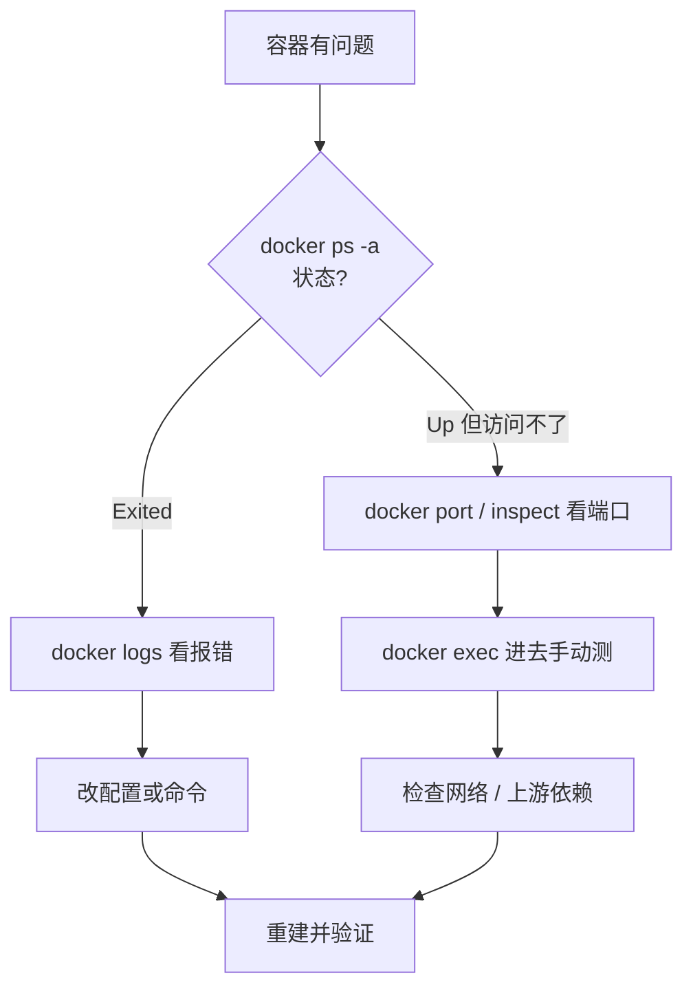

---
tags:
  - Docker
  - 速查
  - 排错
created: 2026-11-06
---

# 10 镜像速查与排错

> [!info] 参考
> 热门镜像：<https://yeasy.gitbook.io/docker_practice/appendix/repo>
> 命令查询：<https://yeasy.gitbook.io/docker_practice/appendix/command/docker>
> 常见错误：<https://yeasy.gitbook.io/docker_practice/appendix/faq/errors>

## 10.1 常用镜像启动命令

```bash
# Nginx：静态站点
docker run -d --name nginx -p 80:80 \
  -v ${PWD}/html:/usr/share/nginx/html:ro \
  nginx:1.28-alpine

# MySQL 8
docker run -d --name mysql -p 3306:3306 \
  -e MYSQL_ROOT_PASSWORD=123456 \
  -e TZ=Asia/Shanghai \
  -v mysql-data:/var/lib/mysql \
  mysql:8

# PostgreSQL 16
docker run -d --name pg -p 5432:5432 \
  -e POSTGRES_PASSWORD=123456 \
  -v pgdata:/var/lib/postgresql/data \
  postgres:16

# Redis：带密码 + AOF 持久化
docker run -d --name redis -p 6379:6379 \
  -v redis-data:/data \
  redis:7 redis-server --appendonly yes --requirepass 123456

# MongoDB
docker run -d --name mongo -p 27017:27017 \
  -e MONGO_INITDB_ROOT_USERNAME=admin \
  -e MONGO_INITDB_ROOT_PASSWORD=123456 \
  -v mongo-data:/data/db \
  mongo:7

# MinIO：S3 兼容对象存储
docker run -d --name minio -p 9000:9000 -p 9001:9001 \
  -e MINIO_ROOT_USER=admin -e MINIO_ROOT_PASSWORD=12345678 \
  -v minio-data:/data \
  minio/minio server /data --console-address ":9001"

# Node.js 开发环境
docker run -it --rm -p 3000:3000 \
  -v ${PWD}:/app -w /app node:20-alpine sh
```

> [!tip] 端口别照抄
> 宿主机 3306 / 6379 如果已经有本机服务占用，左边换成 13306 / 16379 即可，容器内端口不用动。

## 10.2 命令速查

| 需求 | 命令 |
| --- | --- |
| 拉镜像 | `docker pull nginx:1.28` |
| 看本地镜像 | `docker images` |
| 构建 | `docker build -t app:v1 .` |
| 起容器 | `docker run -d --name app -p 8080:80 app:v1` |
| 看运行中 | `docker ps` |
| 看全部 | `docker ps -a` |
| 日志 | `docker logs -f app` |
| 进容器 | `docker exec -it app sh` |
| 停 / 启 / 删 | `docker stop app` / `start` / `rm -f app` |
| 看详情 | `docker inspect app` |
| 资源占用 | `docker stats` |
| 磁盘占用 | `docker system df` |
| 清理 | `docker system prune` |
| 拷文件 | `docker cp app:/path ./local` |
| 提交镜像 | `docker commit app app:snap` |
| 存 / 载镜像 | `docker save -o a.tar app:v1` / `docker load -i a.tar` |

## 10.3 错误对照表

| 现象 | 原因 | 处理 |
| --- | --- | --- |
| `Cannot connect to the Docker daemon` | 服务未启动 / 无权限 | 起服务；用户加入 docker 组 |
| `permission denied ... docker.sock` | 不在 docker 组 | `sudo usermod -aG docker $USER` 后重新登录 |
| `pull access denied` / `manifest unknown` | 镜像或 tag 不存在、需要登录 | 检查拼写；`docker login` |
| `port is already allocated` | 宿主机端口被占用 | 换端口或杀掉占用进程 |
| `exec format error` | 架构不匹配 | 用对应架构镜像或 buildx 构建 |
| `no such file or directory` | 缺解释器 / 缺 glibc 依赖 | 检查 shebang；Alpine 缺 glibc |
| 容器启动即退出 | 主进程执行完就结束 | `docker logs` 看原因，改 `CMD` |
| 容器被 kill，退出码 137 | OOM 或 `kill -9` | 提高 `--memory`，查内存泄漏 |
| 容器内无外网 | DNS / 转发问题 | 检查 `daemon.json` 的 dns 配置 |
| 改动配置没生效 | 挂载覆盖或没重启 | `docker inspect` 看挂载；`docker restart` |
| 镜像越来越大 | 缓存没清、没多阶段构建 | 优化 Dockerfile，见 [[06-Dockerfile]] |
| 磁盘满了 | 日志、悬空镜像、构建缓存 | 配日志轮转；`docker system prune` |

## 10.4 排查套路



几条经验：

1. **先看日志，别猜**。90% 的问题日志里写着。
2. **进容器手动复现**，比在宿主机上想更快。
3. `docker inspect` 是真相来源——挂载、环境变量、网络、重启次数都在里面。
4. 改完 `daemon.json` 一定要 `systemctl restart docker`。
5. 怀疑资源问题时先看 `docker stats` 和退出码 137。

## 10.5 一页速记

```text
镜像：pull / images / rmi / build / tag / save / load / push
容器：run / ps / logs / exec / cp / stop / rm / inspect / stats
数据：volume create|ls|rm / -v name:/path / -v /host:/path
网络：network create|ls|inspect / --network / -p 宿主:容器
编排：compose up -d|ps|logs|exec|down
清理：system df / system prune / image prune / builder prune
```
